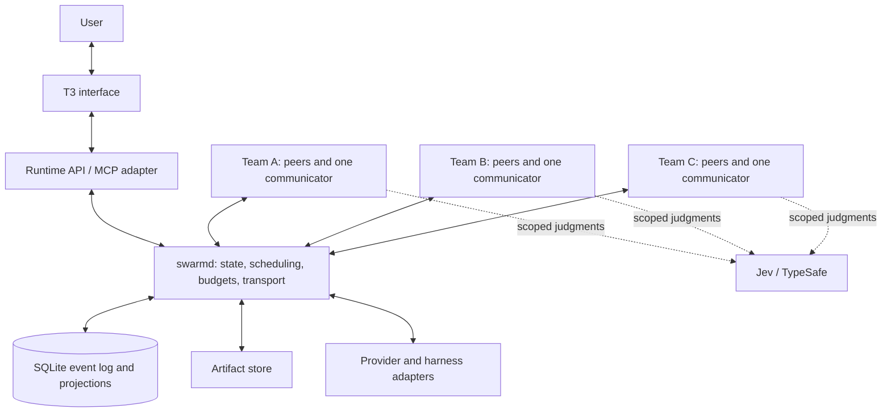

# Fractal swarm runtime: implementation plan

- Date: 2026-10-30
- Status: design ready for implementation; no runtime or provider integration has been built by this document.
- Working name: `swarmd`
- Interface: T3 Code
- Decision service: Jev through the direct TypeSafe API

This is a plan for a standalone product. Its placement in Cyanide's `docs/` directory is a convenient storage location, not a decision to embed the runtime in the iOS application. Implementation should start in a separate repository/workspace. Names, interfaces, limits, and milestones below are proposed implementation choices unless identified as user requirements.

## 1. Decisions and requirements

| Area | Decision |
| --- | --- |
| Initial participation | Three peer agents receive the goal. No permanent planner, manager, or lead agent. |
| Interface | T3 submits goals, conveys user changes, displays progress, and presents results. The interface conversation does not govern the swarm. |
| Visualization | A live, expandable team-creation tree accessed through T3, with agent details and optional contract/message links. |
| Emergency stop | One operator action stops admission and terminates all owned swarm execution across all active goals; it does not depend on an LLM or team vote. |
| Runtime | A separate durable process owns execution state, resource accounting, transport, and recovery. |
| Team autonomy | Agents negotiate temporary roles and responsibilities. Teams can recruit additional teams using the same protocol at every level. |
| Growth | Recursive growth and contraction within finite resource limits. There is no promise of literally infinite agents or spending. |
| External communication | One communicator slot per team, with at most one valid lease. Team-to-team traffic passes through its holder. |
| Model diversity | Teams may mix model families. Family homogeneity is an experiment, not a requirement or presumed token discount. |
| GPT provider | All GPT work uses the user's `codex-6` provider instance. |
| GPT default | GPT-6.1 Sol, high reasoning. Other GPT choices remain possible through that provider; the earlier wording was not a model allowlist. |
| Claude provider | All Claude work uses the user's `claude_v1` provider instance. |
| Claude default | Opus, medium effort. Other Claude choices remain possible through that provider. |
| Scoped work | Prefer DeepSeek V4.1 Flash when task capability and context eligibility permit. |
| Cyber reasoning | Daybreak Blue high; xhigh for substantial work. Kimi K3.1 Pro max is the next capability/validation recovery choice. Daybreak remains an explicit GPT exception. |
| Cyber eligibility | Daybreak Blue, Mythos, Kimi, DeepSeek, and GLM are the user-designated pool. Ordinary Sol/Opus workers do not receive restricted cyber context. |
| Kimi provider order | TokenRa discounted K3.1 Pro route first, then TokenRa regular, then OpenRouter as allowances are exhausted. |
| DeepSeek provider order | DeepSeek Harness, then OpenCode Go, then OpenRouter as allowances are exhausted. |
| GLM | GLM 5.3 Flash through OpenCode Go. |
| Decision API | Integrate Jev through TypeSafe directly. No Luna or gateway fallback is enabled in v1. |
| Confidence | Preserve uncertainty, evidence, verifier outcomes, and measured reliability throughout the swarm. |
| Measurement | Track total work, tokens, cost, delay, errors, and coordination overhead before claiming benefits from swarming. |

Model labels and provider names above are user requirements. Exact native model IDs, provider instance IDs, effort options, entitlements, and quotas must be discovered and verified during the first milestone. Display names are not interchangeable with API IDs.

## 2. Architecture and authority

The runtime coordinates mechanics. Teams decide how to solve their contracts. Jev supplies bounded judgments. T3 represents the user. None of these roles creates a permanent global LLM leader.



The diagram's team links represent logical participants; all outbound calls, including Jev calls, pass through runtime admission and accounting. Team A can create B, and B can create C. This records provenance and contracts without making A the superior of every later team. Teams may also contract with eligible existing peers.

### Runtime responsibilities

- Persist goals, revisions, contracts, claims, leases, messages, artifacts, usage, and outcomes.
- Admit work against permissions, scope, provider eligibility, budgets, and available capacity.
- Execute proposals already made by teams and resolve mechanical races deterministically.
- Deliver events, reclaim expired leases, back off failed providers, and recover after restart.
- Validate schemas and enforce state transitions.
- Materialize completion criteria and evidence coverage for the user interface.

The runtime does not generate a global solution plan, appoint a permanent chief agent, or use a hidden model to override every local decision.

### Team responsibilities

- Interpret the current contract and propose how to satisfy it.
- Claim work, negotiate temporary roles, investigate, implement, and verify.
- Ask other teams for bounded deliverables when useful.
- Discuss conflicting evidence and uncertainty.
- Publish results with evidence and unresolved limitations.

### T3 responsibilities

- Submit, amend, inspect, pause, resume, and cancel goals.
- Convey genuine user constraints and resolve necessary user questions.
- Display durable runtime state; reconnect without recreating the swarm.
- Present the completion manifest and peer-produced explanations.

Closing the T3 conversation must not stop an otherwise authorized goal. A running interface agent must not be required to repeatedly wake, poll, or delegate for the runtime to continue.

## 3. Research to adopt and boundaries to change

| Source | Useful mechanism | Application here |
| --- | --- | --- |
| [AutoGen Swarm](https://microsoft.github.io/autogen/stable/user-guide/agentchat-user-guide/swarm.html) | Capability-based handoff and local decisions about the next participant. | Use explicit handoff contracts and termination conditions. Replace its shared group-chat context with team-private state and scoped exports. |
| [LangGraph Swarm](https://github.com/langchain-ai/langgraph-swarm-py) | Customizable handoff tools, persistence, and configurable agent state. | Preserve resumable conversations and explicit transfer payloads. Avoid full-history handoffs across the entire swarm. |
| [Swarms router implementation](https://github.com/kyegomez/swarms/blob/master/swarms/structs/swarm_router.py) | Multiple execution topologies, structured configuration, and reusable execution patterns. | Support bounded parallel work and explicit topology configuration without adopting a mandatory director. |
| [AutoSwarm](https://github.com/HKUDS/AutoSwarm) | Integration with different existing agent products and native runtime capabilities. | Separate an agent/harness adapter from a model API adapter; preserve account and session identity. |
| [T3 provider constraints](https://github.com/pingdotgg/t3code/blob/main/docs/internals/providers.md) | Provider-instance isolation, explicit capabilities, and portable handoffs when native continuation is unavailable. | Bind routes to exact instances. Keep provider quirks at the adapter boundary. |
| [HarnessJevBench](https://github.com/agentscope-ai/HarnessJevBench) | Tests at routing, dispatch, budget, completion, and recovery decision points. | Reuse the categories when constructing our own evaluation set. Its offline results do not establish our runtime's end-to-end success. |

These are design inputs, not evidence that the proposed combination already works. No framework above supplies the whole requested system unchanged. Build a small runtime around the required contracts rather than integrating several competing orchestrators.

[Reddit coordination discussion](https://www.reddit.com/r/LocalLLaMA/comments/1wu3rio/agent_swarm_coordination/) supplied useful experiment ideas: artifact-based handoffs, expiring claims, capped iteration, and comparison with a single-agent baseline. Treat those as anecdotal engineering leads. The [Swarms X announcement](https://x.com/swarms_corp/status/2032556332054925468) could not be fetched during this research; no technical or performance conclusion here relies on it.

## 4. Implementation stack and repository shape

Proposed v1 stack:

- TypeScript with a supported Node.js LTS release, pinned when implementation begins.
- One `swarmd` process on one host, with worker sessions/processes behind adapters.
- SQLite in WAL mode for transactional state, durable events, and outbox delivery.
- A content-addressed filesystem store for immutable artifacts and large payloads.
- A local authenticated HTTP API, an SSE event feed, and an MCP adapter for T3.
- JSON Schema validation at every model/runtime boundary.
- Structured logs and local metrics; external telemetry is optional.
- A small independent `swarm-guard` supervisor owns the emergency-stop latch and execution process registry.

The first implementation targets macOS and Linux on a single host. Multi-host execution, replicated storage, and automatic infrastructure provisioning are later work.

```text
fractal-swarm/
  apps/
    swarmd/                  # durable daemon and API
    swarm-guard/             # stop authority and owned-process supervisor
    swarmctl/                # CLI against the same API
    t3-bridge/               # thin client/MCP integration
    swarm-view/              # live topology panel/dashboard
  packages/
    contracts/               # versioned schemas and state machines
    runtime/                 # admission, scheduling, lifecycle
    transport/               # mailboxes, outbox, delivery, fences
    storage/                 # migrations, transactions, projections
    providers/               # registry, quotas, routing, errors
    harness-bridge/          # configured native agent runtimes
    decisions-typesafe/      # Jev client and decision policies
    evidence/                # claims, provenance, verifier receipts
    evaluation/              # replay, baselines, calibration
  config/
    pilot.example.json
  docs/
    architecture.md
    adapters.md
    operations.md
```

Credentials remain in the owning provider's credential mechanism or an explicit secret reference. Configuration and event logs contain references and identities, never copied refresh tokens or raw secrets.

## 5. First milestone dependency: independent worker execution

This is the first engineering risk to resolve, before building a large scheduler.

T3 documents an [external MCP surface](https://github.com/pingdotgg/t3code/blob/main/docs/user/outside-agents.md). Its [app-owned delegation surface](https://github.com/pingdotgg/t3code/blob/main/docs/orchestration-v2/orchestrator-mcp-server.md) requires an active parent run for `delegate_task`. Consequently, a loop of calls from this interface conversation cannot be the standalone execution engine.

Implement the following separation:

1. `swarmd` owns worker IDs, contracts, messages, admission, and recovery.
2. `WorkerExecutor` starts, resumes, cancels, and inspects one worker through a configured harness adapter.
3. The GPT adapter binds to the actual `codex-6` configuration; the Claude adapter binds to `claude_v1`.
4. Reuse supported native harness protocols or a narrow provider bridge. Verify the installed T3/provider versions before deciding whether to reuse a provider package or implement a separate bridge.
5. T3 transports user commands and runtime events independently of those workers.

Proposed adapter contract:

```text
discoverCapabilities(instanceRef)
startWorker(workerSpec, invocationKey)
resumeWorker(sessionRef, contextRevision, invocationKey)
cancelWorker(runRef, cancellationKey)
readWorkerState(runRef)
subscribeWorkerEvents(runRef, cursor)
```

Normalize session IDs, turn boundaries, pending questions, cancellation, tool calls, usage, and terminal outcomes. A native agent session and a raw chat completion are different execution modes; do not run a second agent tool loop around an already autonomous harness.

Required proof: start a worker, disconnect the T3 interface, obtain its result, restart `swarmd`, and recover its identity and state without an extra billable duplicate. If a provider cannot support the required bridge, mark that integration unready. Do not silently replace `codex-6` or `claude_v1` with another service.

Worker adapters must prevent untracked native subagents and autonomous continuation from bypassing runtime admission. Every billable nested session must either be registered as a worker or disabled. Prompt instructions alone do not enforce this boundary.

Give each worker a scoped runtime credential bound to its goal, team, worker identity, and permitted commands. Validate the authenticated identity rather than trusting sender IDs in a message body. Keep runtime storage and other teams' session files outside worker-accessible workspaces. An adapter with unrestricted host access cannot advertise enforced team isolation; M0 must prove the required sandbox/tool boundaries or mark that isolation mode unsupported.

## 6. Bootstrap and natural role formation

### Goal admission

A goal supplies:

- Objective and acceptance criteria.
- Workspace/artifact access and allowed actions.
- Workload/context eligibility policy, including any cyber classification.
- Resource limits and provider configuration revision.
- Relevant user constraints and a versioned goal revision.

Classify context eligibility before fan-out. Unknown eligibility cannot be resolved by sending raw content to every candidate model. Use explicit user/workspace policy or a permitted assessor; retain unresolved cases until an eligible route exists.

### Initial peers

For an ordinary goal, the proposed initial composition is:

1. GPT-6.1 Sol high through `codex-6`.
2. Claude Opus medium through `claude_v1`.
3. DeepSeek V4.1 Flash through its highest-priority available entitlement.

These are three peers, not planner, critic, and subordinate. Each receives the same eligible goal contract and publishes a short independent proposal. The model defaults express starting preferences, not proven comparative strengths.

For a restricted cyber goal, use an eligible bootstrap profile instead: one Daybreak Blue worker and two scoped DeepSeek workers. Kimi remains available for the agreed capability recovery path. This avoids exposing the goal to ordinary Sol or Opus merely to perform initial triage. The profile requires three eligible slots; otherwise it waits for capacity rather than silently changing the requested initial participation.

### Roles and claims

Every peer can submit a role/work proposal containing:

```text
contract_id, objective, skill_tags, proposed_deliverable,
required_inputs, expected_duration, resource_estimate,
self_reported_uncertainty, conflicts, dependencies
```

The team assigns expiring work claims using those proposals and evidence about previous results. Roles such as implementer, investigator, verifier, or integrator may emerge for one contract and change later. The runtime prevents duplicate claims and resolves exact ties deterministically; it does not invent the substantive work plan.

Keep initial negotiation bounded: one proposal round and one reconciliation round. Further discussion requires a concrete unresolved question, new evidence, or a changed constraint. Record dissent instead of forcing confident agreement.

The default team rule is a majority of current members for reversible work allocation and recruitment within the contract. A solo leaf can assign its own work but cannot waive an independent-verification requirement. A substantive disagreement about correctness triggers evidence gathering or targeted review; an allocation vote does not establish truth. Membership changes invalidate outstanding votes and role assignments that depended on the previous roster.

Initial teams have three members. Later teams normally have three, with one-member scoped leaves allowed when another team can independently verify their output. Team membership changes are explicit, versioned events.

## 7. Communicator protocol

One member holds the team's communicator lease. This is a transport responsibility, not special authority to decide the team's work.

If the lease expires, external sends pause until a replacement is installed. A membership change that removes the communicator revokes its lease in the same transaction. Temporary absence is allowed; two simultaneously valid communicators are not.

- Team members exchange local messages and publish to their private board.
- Only the lease holder can submit external team messages, recruit contracts, or export team results.
- Incoming external messages enter the team's mailbox and are made available to members through the communicator and board.
- Deterministic runtime control events, such as cancellation or lease expiry, do not need an LLM relay.
- Members may call admitted local tools, including provider execution and Jev. Those calls do not grant a second team-to-team communication channel.

Selection uses a majority of current members. The first communicator can be assigned deterministically for transport bootstrap and then replaced by a team election. A small team that cannot reach a transport election uses the documented deterministic tie-break after timeout. This cannot decide substantive disputes.

Proposed lease defaults: 60-second duration, renewal every 20 seconds, monotonically increasing generation. Renewals are runtime operations and consume no model call.

Every external command carries the lease generation. A single database transaction validates the sender, current membership, unexpired generation, goal revision, and permissions before accepting the command. Rotation revokes the previous generation.

Delivery rules:

1. Repeated accepted command IDs return their original receipts without another effect.
2. New commands from stale communicator generations are rejected.
3. Messages accepted before rotation retain their acceptance records; later redelivery cannot apply them twice.
4. An unsent, unaccepted old-generation message must be explicitly superseded by the new communicator.
5. A communicator failure does not erase the team's board, work claims, or contracts.

A worker cannot bypass this by reading another team's private transcript, invoking a different agent's session directly, or writing into an external team's inbox.

## 8. Fractal growth, contracting, and contraction

Each team uses the same recruit protocol. There is no hard-coded distinction between a top-level planner and a deeply nested team.

### Recruit only for a concrete need

A recruitment proposal must identify:

- A deliverable and acceptance criteria that can be checked.
- Why current members cannot efficiently produce it.
- The smallest sufficient team/capability profile.
- Required context, tools, dependencies, and scope.
- Estimated resource use and expected benefit.
- How the result will be verified and integrated.

Prefer contracting with an idle eligible team before creating another. Do not split a trivial serial task solely to make the topology deeper.

### Admission sequence

1. A member proposes recruitment on the local board.
2. The team accepts the scoped proposal; its communicator submits it.
3. The runtime checks scope, dependency cycles, eligibility, duplicate work, available budget, and capacity.
4. Atomically reserve the necessary allocation and record the contract before launch.
5. Reuse an eligible team or instantiate the requested members.
6. The receiving team acknowledges the contract and negotiates its internal work.
7. That team may repeat the protocol for a smaller subproblem.

The contract graph must remain acyclic for blocking dependencies. Communication links can be peer-to-peer through communicators. Record creation ancestry separately from contract dependencies.

### Contraction

- Dormant teams retain durable state but do not keep model calls or execution slots running.
- Completed leaves return unused allocations and archive their context exports.
- An idle team can accept a new compatible contract without creating another team.
- Retire duplicate or unproductive branches after bounded review.
- A requester waiting for contracted work releases its model-call slot.
- Limit live teams, active calls, total spawn events, elapsed time, and total work. Additional depth is possible as capacity is released, until the goal's finite budget is exhausted.

Autonomy includes deciding not to grow. The evaluation must check whether recruitment actually saves time or improves verified results.

## 9. Contracts, state, and completion

### Contract fields

```text
id, schema_version, goal_id, goal_revision,
requester_team_id, supplier_team_id, contract_revision,
objective, acceptance_criteria, deliverable_schema,
input_refs, permitted_exports, context_eligibility,
allowed_tools, workspace_scope, dependencies,
budget_allocation_id, deadline, verification_policy,
status, result_refs, unresolved_claims
```

Requirements and outputs are versioned. An agent must not change its own acceptance criteria to turn an incomplete result into a success.

### States

| Entity | Main states |
| --- | --- |
| Goal | `admitted`, `active`, `paused`, `waiting_input`, `budget_exhausted`, `completed`, `cancelled`, `emergency_stopped`, `failed` |
| Contract | `proposed`, `accepted`, `ready`, `running`, `waiting_dependency`, `waiting_resource`, `verification`, `completed`, `failed`, `cancelled`, `superseded` |
| Worker turn | `queued`, `admitted`, `running`, `waiting_tool`, `waiting_input`, `completed`, `failed`, `cancelled`, `outcome_unknown` |
| Team | `forming`, `active`, `dormant`, `draining`, `retired` |

Use explicit failure reasons. Waiting for capacity, missing user input, provider exhaustion, and an unsolved technical issue are different states.

### User amendments

A new user constraint increments the goal revision and identifies affected contracts. Cancel, supersede, or revalidate their pending actions. Results from an older revision remain historical evidence but cannot silently satisfy changed acceptance criteria. Narrowing eligibility also revokes pending context exports and dispatches.

### Completion

Completion requires a manifest mapping every acceptance criterion to deliverables and current verifier receipts, with no unresolved required dependency. A peer may challenge missing evidence. A temporary integrator can assemble the manifest; this does not create a permanent leader.

The runtime validates manifest coverage and state consistency. A designated eligible verifier checks substantive criteria. Votes and Jev scores cannot substitute for required tests or other observable evidence. Necessary integration/review capacity is reserved before admitting more exploratory work.

## 10. Provider and model routing

### Separate four identities

Keep `logical_model`, `native_model_id`, `provider_instance`, and `entitlement_pool` separate. A provider instance can expose several models and shared quotas. A single model can appear through several providers with different capabilities and accounting.

| Logical route | Provider restriction | Initial reasoning policy |
| --- | --- | --- |
| General GPT | `codex-6` only; default GPT-6.1 Sol | high |
| General Claude | `claude_v1` only; default Opus | medium |
| Scoped work | DeepSeek V4.1 Flash chain | provider-supported setting, verified at setup |
| Cyber reasoning | Daybreak Blue through `codex-6` | high; xhigh when substantial |
| Cyber capability recovery | Kimi K3.1 Pro chain | max, if advertised by the exact route |
| Optional cyber specialist | Mythos through `claude_v1` | explicit configured effort; no invented option mapping |
| Additional eligible worker | GLM 5.3 Flash through OpenCode Go | verified provider-supported setting |
| Narrow decision service | TypeSafe direct Jev | pinned model; no chat reasoning setting |

Mythos remains an eligible optional specialist, with refusals and availability measured. It is not inserted ahead of the user's Daybreak-to-Kimi preference. DeepSeek, Kimi, and GLM can also perform suitable ordinary work.

### Entitlement chains

```text
Kimi K3.1 Pro:
  Kimi / TokenRa / verified 80%-off offering
  -> Kimi / TokenRa / regular offering
  -> Kimi / OpenRouter

DeepSeek V4.1 Flash:
  DeepSeek Harness
  -> OpenCode Go
  -> OpenRouter

GLM 5.3 Flash:
  OpenCode Go

Jev:
  TypeSafe direct
```

Do not treat the two TokenRa offerings as separate wallets unless their quota contracts establish that. Confirm their exact offering IDs and any shared balance. The discount is a user-reported entitlement until verified on the actual account.

Preserve chain order. A latency estimate does not silently spend on OpenRouter while a higher-priority entitlement remains usable. Temporary provider failures may activate the configured availability fallback, with a reason, cooldown, and return to the higher-priority route when healthy.

Paid fallback on temporary outages is disabled by default. Enable it only through an explicit goal/provider policy; otherwise wait for the preferred route or let the team choose another eligible capability without changing that route's entitlement order.

### Dynamic model choice inside explicit boundaries

The runtime first filters candidates deterministically by context eligibility, provider restrictions, required tools, context size, effort support, budget, and availability. Teams choose among the remaining candidates using task needs and measured capability records. Jev may later advise on task fit for evaluated decision types.

Record a route receipt containing candidates, exclusions, selected model/provider/effort, entitlement tier, policy revision, and reason. Neither a learned score nor an agent role proposal can override a hard restriction.

If the exact provider or effort setting is unavailable, report that route unavailable. Do not silently change account, model, effort, or service. Native continuation is used only within a compatible provider/session; switching providers creates a scoped handoff with explicit evidence, pending work, and failure state.

For Daybreak, classify work as substantial when it requires consequential cross-component reasoning, difficult failure analysis, or several dependent verification stages. Record that classification when selecting xhigh. Isolated bounded work retains high unless its evidence justifies a change.

### Cyber routing and failure semantics

Cyber eligibility applies to every recipient, including bootstrap peers, reviewers, interface models, summarizers, and decision tools. Jev is not automatically added to the raw cyber-context pool. An eligible team handles those judgments until a separate eligibility policy explicitly permits a decision-service payload.

Treat Daybreak-to-Kimi recovery as a capability, execution, or verification path within the permitted task scope. A provider content-policy refusal is recorded separately from quota, format, and transport failures. Do not implement automatic prompt rewriting or provider hopping solely to evade a content-policy refusal. The earlier proposed GLM Refuseless/abliterated refusal-triggered route is not enabled in v1.

The standalone runtime's policy must be explicit rather than inheriting this planning session's local delegation scripts. Workspace-specific instructions and action permissions still apply to the actual work performed there.

### Error taxonomy

| Condition | Runtime behavior |
| --- | --- |
| Short-term rate limit | Queue or retry with bounded backoff and provider retry hints; do not assume allowance exhaustion. |
| Confirmed credits/quota exhausted | Advance the configured entitlement chain; retain exhaustion/reset metadata. |
| Authentication/configuration failure | Disable the affected route pending correction; do not repeatedly spend calls probing it. |
| Timeout or transient service error | Inspect retained run state before retrying; bounded retry, circuit breaker, then configured availability path. |
| Invalid typed result | One bounded format repair if meaningful; otherwise preserve failure and return to the team. |
| Valid result fails verification | Record a capability failure; revise the approach or use the configured stronger eligible model. |
| Content-policy refusal | Preserve the reason and scope; return to the team for a permitted resolution. |
| Unknown remote outcome | Retain reservation and inspect the provider/session before any replay. |

## 11. Jev integration through TypeSafe

### Connection and scope

Use the [native System One API](https://docs.typesafe.ai/introduction/quickstart):

```text
POST https://api.typesafe.ai/v1/systemone
model: jev-1.14.0
credential: secret reference resolved at execution
```

[TypeSafe's model reference](https://docs.typesafe.ai/models) lists input-only billing, free output, versioned models, and organization-specific rate limits. The currently documented input rate is $0.042 per million tokens; store a dated pricing revision rather than hard-coding a permanent price.

Use a pinned version after calibration. A version update creates a new evaluation/calibration revision. OpenRouter can be evaluated later as a transport alternative, but the user's selected v1 route is TypeSafe direct only. Luna remains outside v1.

Jev is a stateless tool call through runtime admission, not another swarm member. It cannot execute tools, inspect an artifact path on its own, or supply an arbitrary written explanation. Assemble the actual relevant evidence in the request.

The initial integration uses text/JSON decision payloads. Image and Box capabilities are outside this implementation slice and require separate route-specific evaluation.

### Initial decision classes

| Decision | Initial behavior | Possible promotion after evaluation |
| --- | --- | --- |
| Result lacks necessary evidence | Advisory alongside peer review | Request an additional bounded check |
| Proposed work duplicates an existing contract | Advisory shortlist after deterministic filtering | Suppress a clearly duplicate recruitment proposal |
| Contradictory claims require reconciliation | Advisory | Route to an eligible reviewer |
| Task fits an existing capability category | Shadow classification | Rank already-eligible candidate profiles |

Do not give Jev sole authority over goal completion, substantive cyber analysis, permissions, financial budgets, or irreversible actions. These remain with deterministic policy, the authorized team, and required verification.

### Example native payload

```json
{
  "model": "jev-1.14.0",
  "state": {
    "contract": {
      "objective": "Determine whether the parser handles empty input",
      "acceptance": "A current test demonstrates the expected empty-input result"
    },
    "result": {
      "claim": "Empty input is handled",
      "evidence": "The supplied test log shows only the nonempty-input test"
    }
  },
  "questions": {
    "evidence_status": {
      "type": "choice",
      "instructions": "Does the supplied evidence establish this acceptance criterion? Use only the supplied state.",
      "criteria": {
        "established": "Current evidence directly demonstrates the required behavior",
        "contradicted": "Current evidence demonstrates incompatible behavior",
        "insufficient": "The evidence does not demonstrate either outcome"
      }
    }
  }
}
```

The production envelope adds source IDs, hashes, relevant goal/contract revisions, and verifier receipts. Text from artifacts is evidence, not permission to change runtime policy.

### Calling policy

- Start in shadow mode: recommendations are recorded without changing execution.
- Trigger at useful checkpoints, such as a result submission or recruitment proposal. Do not judge every message.
- Batch independent questions over the same scoped state when economical.
- Keep dependent judgments in separate steps.
- Reuse existing structured state; an expensive summary call solely to feed Jev must count against its benefit.
- Bound payload size and queue time. Prefer small excerpts and explicit missing-evidence outcomes.
- Cache only exact decision inputs with the model, question, policy, and evidence revisions in the cache key.
- Validate answer types, allowed values, and probability fields. Preserve malformed responses as failures rather than silently repairing probabilities.
- On uncertainty, timeout, or service failure, return the judgment to the team. A Jev outage does not permanently stop the goal.

Log decision type, route/version, state hash, question revision, raw answer, usage, latency, calibration revision, chosen action, and eventual verified outcome. Store concise evidence-linked explanations from peers; do not invent an explanation on Jev's behalf.

## 12. Confidence, evidence, and disagreement

Confidence is recorded per claim and decision, not as one global swarm score.

| Field | Meaning |
| --- | --- |
| `self_report` | A worker's own stated uncertainty; retain model and question provenance. |
| `probabilities` | A judge's estimated distribution over defined outcomes. |
| `raw_confidence` | The provider's confidence statistic, with its schema/version. |
| `evidence_refs` | Sources and artifacts supporting or contradicting the claim. |
| `verification` | Pending, passed, failed, or inconclusive, with actual receipts. |
| `calibrated_reliability` | Observed reliability on comparable held-out decisions; null when unsupported. |
| `disagreement` | Competing claims, evidence, and the unresolved point. |

Jev's [confidence documentation](https://docs.typesafe.ai/confidence) defines its field as a statistic derived from the probability distribution. A concentrated distribution is not independent proof that the answer is correct. Retain the full probabilities and calibrate actions against outcomes.

Rules:

- Never convert confident prose into verified status.
- Never average arbitrary worker confidence values into a probability of correctness.
- Track shared sources and dependencies: several agents repeating one source are correlated evidence.
- Separate missing evidence from contradictory evidence.
- Give uncertain choices an explicit insufficient-information/defer path.
- Publish the reason for confidence changes: new evidence, a verifier result, a scope change, or a calibration update.
- Preserve dissent in handoffs until it is resolved with evidence or explicitly accepted as a limitation.

Use cheap local checks first. If a conclusion matters and evidence conflicts, seek one targeted independent review. Escalation must answer a specific unresolved question and have an allocated budget; repeated voting without new evidence is not progress.

### Calibration procedure

1. Collect labeled examples for each proposed automatic decision type.
2. Prefer deterministic receipts or independently reviewed labels. Do not use agreement with a single favorite model as the only ground truth.
3. Split by goal/task family before selecting thresholds, avoiding nearly identical variants across training and held-out sets.
4. Measure probability calibration, error by class, and error versus the share handled without escalation.
5. Choose thresholds from the cost of mistakes for that decision type; include uncertainty from sample size.
6. Validate on held-out goals, then enable only the qualifying classes.
7. Re-evaluate after model, gateway, question, policy, or material workload changes.

No universal `0.9` threshold is promised. Sparse evidence leaves reliability unknown and the decision advisory. Hard permissions and scope restrictions never become probabilistic thresholds.

## 13. Resource accounting and quota-aware scheduling

### Three different quantities

1. Provider-reported usage and billing.
2. Remaining entitlement or subscription allowance.
3. Internal work/resource allocations and comparable cost estimates.

Keep them separate. A prepaid allowance is not unlimited merely because marginal cash cost is temporarily low. Record tokens and opportunity cost for harness/subscription routes even where their exact monetary billing is unavailable.

For each billable attempt, record provider instance, entitlement pool, native model, effort, input/output usage, cache details, reasoning usage when exposed, request ID, timestamps, failure, billed cost when available, and estimate provenance. Avoid double-counting cached or reasoning tokens already included in provider totals.

### Reservations

- A single transaction checks global and goal limits, reserves a call allowance, and writes the invocation intent.
- Team allocations subdivide an existing goal allocation; creating a child allocation does not create more money or tokens.
- Settling a call replaces its reservation with actual usage and releases unused allowance.
- Unknown outcomes keep their conservative reservation until reconciled.
- Reserve capacity for verification, integration, and final reporting before funding more growth.
- Enforce both provider-level and goal-level admission limits. One goal cannot consume another's reserve.

An internal ledger alone cannot guarantee a hard provider bill. A harness may contain several model calls or hidden continuation. Each adapter must declare whether it can meter and constrain those calls. Hard monetary guarantees require enforceable per-call/provider limits; an opaque harness exposes an explicitly estimated budget mode with bounded session controls and honest uncertainty. A goal requiring strict enforcement cannot use an adapter that lacks it.

### Quota state

Each entitlement reports `available`, `rate_limited`, `exhausted`, `unavailable`, or `unknown`, with observed time, source, reset time if known, and outstanding reservations.

Prefer a documented quota endpoint when available. Otherwise reconcile reported usage, provider errors, known reset windows, and configured conservative limits. A successful catalog lookup does not prove available quota.

The previously observed TokenRa `/api/usage/token` authentication response is a discovery lead, not a validated balance contract. During implementation, verify authentication scope, units, discount-pool relationships, reset behavior, and eventual consistency before using it for automated tier changes. Never infer remaining allowance from a guessed field.

### Pilot limits

The following are proposed pilot defaults, not previously authorized spending:

| Limit | Proposed value |
| --- | --- |
| Initial peers | 3 |
| Global concurrent billable calls | 12, including Jev |
| Jev concurrent calls | At most 2, within the global limit |
| Live teams | 16 |
| Spawn events per goal | 64 |
| Worker turns per goal | 200 |
| Goal wall-clock budget | 60 minutes |
| Peer links per team | 4, excluding required contract links |
| Coordination rounds per unchanged issue | 2 |
| Initial negotiation | One independent proposal round plus one reconciliation round |
| Verification/integration reserve | 20% of the goal's work allocation |

Every real goal also requires a configured monetary and/or token allowance appropriate to its providers. The daemon does not launch billable work without a valid budget policy. Raising limits changes admission policy and is logged.

Prevent starvation with per-goal fairness, priority aging, and provider-specific rate queues. Dormant teams and dependency waits consume durable state, not model-call slots.

### Example pilot policy

This is the proposed configuration contract for `config/pilot.example.json`. Model and offering references below are logical bindings resolved to the verified catalog manifest from M0. It is not runnable until those bindings, credentials, and an actual goal allowance are supplied.

```json
{
  "schema_version": 1,
  "runtime": {
    "initial_peers": 3,
    "max_concurrent_billable_calls": 12,
    "max_live_teams": 16,
    "max_spawn_events_per_goal": 64,
    "max_worker_turns_per_goal": 200,
    "goal_wall_clock_seconds": 3600,
    "max_peer_links_per_team": 4,
    "max_coordination_rounds": 2
  },
  "communicator": {
    "lease_seconds": 60,
    "renew_every_seconds": 20,
    "require_generation_fence": true
  },
  "visualization": {
    "default_view": "team_creation_tree",
    "show_cross_team_edges": false,
    "mark_communicator": true,
    "show_stale_connection_state": true
  },
  "emergency_stop": {
    "scope": "all_owned_goals",
    "authority": "swarm_guard",
    "durable_latch": true,
    "native_cancel_grace_seconds": 2,
    "terminate_grace_seconds": 2,
    "force_kill_after_grace": true,
    "automatic_rearm": false
  },
  "provider_constraints": {
    "gpt_instance_binding": "codex-6",
    "claude_instance_binding": "claude_v1",
    "allow_silent_substitution": false,
    "allow_paid_fallback_on_temporary_outage": false
  },
  "defaults": {
    "general_gpt": {"model": "gpt.sol_6_1", "effort": "high"},
    "general_claude": {"model": "claude.opus", "effort": "medium"},
    "scoped": {"model": "deepseek.v4_1_flash"},
    "cyber_primary": {"model": "gpt.daybreak_blue", "effort": "high"},
    "cyber_substantial_effort": "xhigh",
    "cyber_capability_recovery": {"model": "kimi.k3_1_pro", "effort": "max"}
  },
  "offering_chains": {
    "kimi.k3_1_pro": [
      "kimi.tokenra.discount80",
      "kimi.tokenra.regular",
      "kimi.openrouter"
    ],
    "deepseek.v4_1_flash": [
      "deepseek.harness",
      "deepseek.opencode_go",
      "deepseek.openrouter"
    ],
    "glm.5_3_flash": ["glm.opencode_go"]
  },
  "decisions": {
    "provider": "typesafe_direct",
    "model": "jev-1.14.0",
    "mode": "shadow",
    "max_concurrent_calls": 2,
    "fallback_routes": [],
    "raw_cyber_context_allowed": false
  },
  "budgets": {
    "goal_allowance_required": true,
    "default_goal_allowance": null,
    "require_adapter_enforcement_declaration": true,
    "verification_and_integration_reserve_fraction": 0.2
  }
}
```

## 14. Durable state and message contracts

### Storage

Use an append-only event table and transactional projections in the same SQLite database. Proposed tables:

```text
goals, goal_revisions, teams, memberships, communicator_leases,
contracts, contract_dependencies, work_claims,
worker_sessions, worker_runs, invocation_intents,
messages, inbox_receipts, outbox,
artifacts, artifact_grants, claims, verifier_receipts,
budget_allocations, reservations, usage_attempts,
provider_instances, entitlement_observations,
decision_requests, decision_outcomes, calibration_revisions,
control_epochs, stop_receipts, owned_execution_resources,
events, command_receipts
```

Use immutable IDs, schema versions, monotonically increasing revisions, and foreign-key constraints. Command receipt, state transition, event, and outgoing message are committed together where one operation requires them.

### External message example

```json
{
  "schema_version": 1,
  "message_id": "msg-unique",
  "idempotency_key": "contract-17:result:revision-2",
  "goal_id": "goal-1",
  "goal_revision": 3,
  "control_epoch": 5,
  "contract_id": "contract-17",
  "sender_team_id": "team-b",
  "sender_agent_id": "worker-b2",
  "communicator_generation": 4,
  "recipient_team_id": "team-a",
  "kind": "result_submitted",
  "payload_ref": "artifact:result-manifest",
  "causation_id": "event-previous",
  "trace_id": "trace-17"
}
```

Message kinds include contract offer/acceptance, clarification, evidence request, result submission, verification result, dispute, cancellation, and closeout. Heartbeats and lease renewal are runtime control operations.

Delivery is at least once with idempotent application. Do not claim exactly-once behavior for arbitrary external tools. A command ID that was accepted locally cannot prove that an interrupted remote mutation did or did not happen; reconcile remote receipts before repeating it.

### Restart and cancellation

- Acquire a daemon ownership lock before admitting new work.
- Check the guard-owned emergency-stop latch before any recovery admission; a restart never clears it.
- Replay committed state and recover outbox entries using their cursors/receipts.
- Inspect running provider sessions before relaunching an invocation.
- Fence expired workers and communicator generations.
- Reconcile reservations and unknown outcomes.
- On cancellation, stop new admission first, revoke relevant leases, cancel owned runs, and retain receipts for late results.
- A late result can update historical usage and evidence without reopening a cancelled contract.

## 15. Memory, artifacts, and workspace access

### Memory scopes

- Worker-private: session-local exploration and concise working notes.
- Team-private: proposals, claims, evidence, local disputes, and contract state.
- Contract export: the minimum required context, deliverable, evidence, and unresolved issues.
- Goal-wide: acceptance criteria, approved shared facts, public capability summaries, and completion coverage.

There is no global concatenated transcript. The directory contains discoverable capabilities and eligibility metadata, not everyone's private messages.

Artifacts are immutable and addressed by content hash, but access remains controlled by grants; knowing a hash does not grant read access. Include provenance, version, scope, and applicable eligibility labels with each export.

Preserve quoted evidence and source references through summaries. A provider switch uses a portable handoff, not a claim of native shared memory. No runtime feature depends on access to hidden model reasoning.

### Coding work

- Give independent edits isolated workspaces/checkouts where the execution adapter supports them.
- Declare file/scope ownership in the contract; shared-checkout execution serializes overlapping writes.
- A temporary integration lease controls applying accepted patches to the integration branch.
- Preserve unrelated user changes. Never reset a dirty workspace to simplify a worker launch.
- Verify assembled changes against the current goal revision; merge conflict resolution is explicit work.
- Commits, PRs, publishing, and deployment follow the goal's actual authorization and project rules.

Evidence types are project-specific. For Cyanide-style research, preserve the distinction between implemented, VM-verified, and physical-device-verified work. A model's successful report cannot upgrade the evidence class.

## 16. T3 API and user interaction

Expose a small runtime API and equivalent MCP tools. These are proposed names, not claims that existing T3 tools already implement them.

| Operation | Purpose |
| --- | --- |
| `swarm.submit_goal` | Validate and persist a versioned goal and its budget policy. |
| `swarm.amend_goal` | Add user constraints and revalidate affected work. |
| `swarm.get_status` | Return current topology, active contracts, usage, and completion coverage. |
| `swarm.read_events` | Read incremental events from a durable cursor. |
| `swarm.read_artifact` | Read an authorized result or evidence artifact. |
| `swarm.answer_question` | Resolve one actual pending question, with idempotent application. |
| `swarm.pause_goal` | Stop new admission and reach a recoverable checkpoint. |
| `swarm.resume_goal` | Revalidate policy/budgets and continue saved work. |
| `swarm.cancel_goal` | Cancel the goal and drain owned execution. |
| `swarm.get_topology` | Return the authorized team/worker graph with an event cursor and control epoch. |
| `swarm.emergency_stop` | Call the guard-owned stop path for all owned goals immediately. |
| `swarm.get_stop_status` | Inspect admission closure, local termination, and unresolved remote cancellations. |
| `swarm.export_run` | Export the manifest, events, usage, and approved artifacts. |

The HTTP event stream supports reconnect from the last event cursor. Worker execution does not depend on a live stream consumer.

Worker tools are a separate surface: `team.post_local`, `work.propose`, `work.claim`, `team.recruit`, `team.send_external`, `artifact.publish`, `claim.record`, and `decision.evaluate`. Recruitment and external sending require the current communicator credential; local proposals do not. Tools accept typed contracts and return durable command receipts. They do not expose arbitrary provider sessions or global private transcripts.

T3 status should show what matters: current deliverables, team activity, unresolved evidence, why work expanded, remaining resources, route changes, and the next expected result. Display observed facts separately from estimates and unknown quota/cost values.

Batch ordinary progress updates. Ask the user only for material missing requirements, actions outside existing authorization, or a necessary unresolved choice. Routine uncertainty is handled by gathering evidence or eligible peer review within the budget.

For restricted cyber context, the interface must either use an eligible model or transport the payload without exposing it to an ineligible interface model. A UI displaying text is distinct from sending that text in an LLM prompt; the implementation must verify that boundary.

### Live branching visualization

The target user experience is a dedicated **Swarm** view accessed through T3. It shows the topology as it expands and contracts without requiring an agent to narrate every event.

T3's [execution graph](https://github.com/pingdotgg/t3code/blob/main/docs/orchestration-v2/README.md) and [thread lineage](https://github.com/pingdotgg/t3code/blob/main/docs/orchestration-v2/thread-lineage-and-context-transfer.md) describe T3-owned runs, provider execution nodes, and related threads. They are not automatic projections of an independent daemon's teams. The runtime therefore needs an explicit topology view and integration; do not manufacture extra T3 conversations just to draw branches.

Implementation path:

1. `swarm-view` renders a runtime-owned snapshot and subscribes to its authenticated event feed.
2. M0 checks the installed T3 version for a supported panel/webview extension. If supported, embed this view; otherwise the native panel requires a small T3 UI integration.
3. The initial working delivery can open the authenticated local dashboard from T3. That is a dashboard reached through T3, not a claim that native inline embedding already exists.
4. Keep the view component and its data contract reusable so native embedding does not change runtime ownership or topology semantics.

Default presentation:

- A declarative goal node at the top, followed by the initial team and recursively created teams. The top node is the user's objective, not a chief agent.
- Team nodes expand to their member agents; the one communicator has a distinct badge.
- Solid branches show team-creation ancestry. Optional dashed links show contracts or communicator-to-communicator traffic. Those links do not turn ancestry into authority.
- Node labels show current work, lifecycle state, model/provider/effort, and a clear distinction between active and waiting work.
- Selecting a node opens its deliverable, recruitment reason, evidence, unresolved questions, reported confidence, calibrated reliability when available, and resource usage.
- Show unknown reliability or billing as unknown. Do not generate a decorative confidence percentage or imply that several agents guarantee correctness.
- Collapse finished branches, search/select teams, filter by state/provider, and inspect a historical event cursor. The live emergency control remains visible even while inspecting history.
- Read-only viewing does not invoke models or create inter-agent messages.

The visualization must use actual runtime events, not a tree inferred from chat prose. Its projection contains stable IDs, `created_by_team_id`, membership revision, communicator generation, contract links, state, usage provenance, evidence summary, control epoch, and event cursor. Large raw transcripts remain behind scoped artifact reads.

Start with a collapsible tree and inspector. Add graph-edge overlays and richer history after stable runtime behavior exists. Collapse/virtualize large branches and coalesce rendering updates; do not rerun a layout or an LLM for every streamed token.

On reconnect, load a snapshot tied to a cursor and replay later events. On missing/gapped events, resynchronize. Mark disconnected or stale data explicitly. The guard's stop status is authoritative for execution controls even if the topology projection is delayed; a late old-epoch event cannot visually restart a stopped swarm.

The [interactive visualization prototype](./fractal-swarm-visualization-prototype.html) uses illustrative local data only. Its branch and stop buttons demonstrate the proposed interaction; they do not connect to providers or terminate real processes.

### Global emergency stop

Provide an always-visible **STOP ALL** control in the Swarm view, plus a CLI path that works without T3. This stops all goals and descendants owned by this `swarmd` instance, including queued work, model calls, Jev requests, pending retries, tool jobs, and owned worker processes. It does not kill unrelated T3 conversations, other applications, or every process with a matching executable name.

The button invokes the stop API directly under the operator's existing session. It does not send a chat prompt, consult Jev, wait for a team vote, or require another confirmation before closing admission. Re-enabling execution is a separate explicit operation.

**Independent authority.** `swarm-guard` owns a durable stop latch, monotonic control epoch, process/session registry, and a local control socket. Worker launches register with the guard before execution. `swarmd` cannot clear the latch through a normal restart, and workers cannot clear it at all. The stop path does not depend on the scheduler, its event loop, a model provider, or a SQLite write lock being healthy.

Persist the latch atomically in guard-owned control storage outside the main SQLite write path, then mirror the receipt into runtime events. A restart reads the latch before any recovery launch. Admission requires a current guard grant; if guard health or the control epoch cannot be established, fail closed for new execution. Give the guard a separate authenticated operator endpoint/socket so a hung main daemon does not prevent an emergency request.

**Stop sequence:**

1. Durably latch the stop, advance the control epoch, and return a stop receipt. From this acceptance point no new billable call, retry, recruitment, or effectful tool job can be admitted.
2. Invalidate outstanding worker grants, communicator leases, execution leases, delayed jobs, and pending dispatches from older epochs. Already accepted remote operations are recorded as in flight.
3. Send provider-native cancellation to every owned run/session and abort open HTTP/stream requests, including Jev calls. Cancel queued work immediately.
4. Give native cancellation up to the configured grace period, then terminate still-running owned process groups. After the second bounded grace period, force-kill remaining owned local processes.
5. Reconcile the process/session inventory and publish stop status. Keep the runtime/guard available for inspection, receipts, and usage reconciliation without launching model work.

Proposed pilot timing: send cancellation immediately, allow 2 seconds for native cancellation, send termination, then allow another 2 seconds before force-kill. These are escalation settings, not a guarantee that a remote provider has stopped computing or billing.

The registry must include process identity/start time, owned descendants, native session IDs, request IDs, pending jobs, and cancellation capabilities. PID reuse must not target a different process. Shared provider servers are cancelled by the owned session; do not terminate a user's shared server merely because one swarm used it. Prove descendant containment for the actual platform or report the residual resources explicitly.

**Honest status.** Report these independently:

- Admission: open or stop latched.
- Owned local execution: stopping, confirmed quiescent, or unresolved, with counts and identities.
- Remote execution: cancellation acknowledged, completed, or unconfirmed.

Closing a socket does not prove remote cancellation. A provider request already accepted may finish or incur charges after the local stop. Retain its usage reservation and expose its unresolved status. Late results may settle usage or be retained as historical evidence; they cannot restart work or commit a stale action.

All live goals affected by the stop enter `emergency_stopped`. This is distinct from a normal pause or orderly single-goal cancellation. No automatic retry, failover, restart policy, queued goal, or daemon reboot re-arms the swarm. An authenticated operator must explicitly clear the latch and start a new run/checkpoint continuation with revalidated scope and budget; clearing the latch alone does not resume old goals.

Proposed operator commands and endpoints, to implement:

```text
swarmctl emergency-stop --all
swarmctl stop-status
swarmctl rearm --stop-id <receipt-id>

POST <guard-endpoint>/v1/control/emergency-stop
GET  <guard-endpoint>/v1/control/stop-status
```

The CLI communicates with the guard directly, bypassing a hung `swarmd`. Its independently maintained owned-process inventory supplies the termination targets. A stop-only credential cannot authorize new execution or re-arm the instance. If the guard itself fails, worker execution grants expire and the containment/watchdog path must stop owned execution; test that behavior rather than assuming parent-process death kills descendants.

Emergency-stop support is a core M1 requirement before autonomous multi-team operation. A disconnected graph must show the connection problem while retaining the stop control; inability to reach the guard must be visible rather than displayed as a successful stop.

### Example goal trace

For an ordinary parser-change goal:

1. T3 submits the objective, workspace scope, acceptance criteria, and resource allowance. The daemon records revision 1.
2. The three peers independently propose useful contributions. They allocate investigation, implementation, and verification as temporary responsibilities.
3. The current communicator contracts a focused compatibility check to another team because that deliverable can proceed independently.
4. That team discovers one smaller independent question and recruits a leaf through the same protocol. The runtime reserves capacity without keeping its requester in an active model call.
5. Jev records a shadow recommendation that the implementation result lacks the required empty-input evidence. The ordinary verifier independently identifies the same gap; the eventual test result becomes a labeled outcome.
6. The teams exchange evidence-linked results through their communicators. The temporary integrator applies accepted changes under its integration lease.
7. A verifier checks the current assembled revision. The completion manifest covers every acceptance criterion, contracted teams close, and unused allocations return.
8. T3 presents the manifest and unresolved limitations. No interface LLM had to supervise the individual work steps.

## 17. Measurement and experiments

Measure complete goals, including failed branches, coordination, context preparation, review, and recovery. A cheap individual Jev request or plentiful DeepSeek allowance does not establish a cheap swarm.

### Metrics

| Category | Measures |
| --- | --- |
| Outcome | Verified acceptance coverage, correctness, unresolved required items, rework |
| Usage | Actual and estimated cost, tokens by category/model/provider, entitlement consumption |
| Time | Goal completion time, queue time, provider-call p50/p95, verification delay |
| Coordination | Messages, coordination tokens, negotiation rounds, duplicate claims, handoff size |
| Growth | Recruitments, reused teams, idle time, useful versus abandoned branches |
| Confidence | Calibration, error by decision class, error versus automated coverage, abstention |
| Recovery | Unknown outcomes, duplicate remote execution, restart recovery, stale commands rejected |

### Required comparisons

1. Single capable agent versus the initial three peers on matched goal families.
2. Fixed three peers versus selective recursive recruitment.
3. Swarm with Jev disabled versus shadow Jev versus evaluated automatic decision classes.
4. Mixed-family teams versus matched same-family teams with the same work and budgets.
5. Structured scoped exports versus larger transcript handoffs.
6. DeepSeek Harness versus OpenCode Go versus OpenRouter for the actual tasks and account conditions.

The experimental harness may select a route explicitly for comparison. Production routing continues to honor the user's entitlement order. Keep model/effort, prompt, workload, context size, concurrency, and cache state visible; do not attribute differences in those variables to model family alone.

No generic same-family token discount is assumed. Count actual cache usage only when the provider reports it. Treat task quality, prompt compatibility, and error correlation as separate outcomes.

### Jev value test

Jev is beneficial when saved agent work and prevented rework outweigh decision calls, context preparation, extra delay, and mistakes. Evaluate this at the goal level and per decision class. A failing class stays advisory or is removed without changing the rest of the runtime.

## 18. Delivery sequence

Each milestone must produce runnable evidence and a short findings document. The current task delivers this plan only.

| Milestone | Deliverable | Acceptance criteria |
| --- | --- | --- |
| M0: adapter and account spike | Verified provider catalog, exact model/effort bindings, native worker bridge, cancellation/ownership capability notes, T3 panel integration check, TypeSafe smoke client, quota discovery notes | GPT and Claude use the required instances; a worker completes after T3 disconnects; identity survives restart; owned process/session cancellation is verified; native Swarm-panel support versus required UI work is documented; Jev returns a valid typed result on an actual authorized call. |
| M1: durable runtime core | Database migrations, command receipts, event log/outbox, scheduler, mock providers, budget reservations, independent guard and emergency-stop latch | Restart preserves accepted work and the stop latch; racing claims have one winner; replay does not duplicate local effects; budget admission is atomic; global stop works with a hung scheduler and fences late dispatch. |
| M2: three-peer cell | Bootstrap, local board, work claims, role negotiation, communicator lease, scoped outputs | Three peers begin without a permanent lead; communicator rotation fences stale commands; local dissent and evidence survive restart. |
| M3: recursive teams | Recruit/accept protocol, team reuse, dependency tracking, contraction | A team created by another team can recruit again through the same API; cycles and duplicate work are rejected; waits release call slots; unused allocation returns. |
| M4: provider policy and recovery | Entitlement chains, typed failures, quota observations, circuit breakers, portable handoffs | Exhaustion follows the specified Kimi/DeepSeek order; rate limits do not masquerade as exhaustion; forbidden recipients never receive payloads; unknown outcomes are inspected before retry. |
| M5: Jev and confidence | TypeSafe adapter, shadow decisions, claim/evidence records, outcome labeling, calibration tooling | Fixed model and question revisions are logged; no automatic action before class-specific validation; a Jev outage returns judgment to the team. |
| M6: T3 interface | Goal tools, event feed, expandable Swarm view and node inspector, status summaries, questions, amendments, pause/resume/cancel, direct STOP ALL control | UI disconnect/reconnect preserves goal execution; live branching matches runtime events; communicator badges and overlay edges are accurate; user amendments fence stale work; STOP ALL bypasses LLM work and reports confirmed versus unconfirmed shutdown. |
| M7: pilot and tuning | Matched benchmark runs, fault-injection results, usage report, operator instructions | Demonstrate verified goal completion within declared resource policy; quantify gains or regressions; validate stop under load, disconnection, and scheduler failure; promote only supported Jev classes and growth policies. |

M0's TypeSafe client can be developed alongside the native-worker spike. M1 can use mocks while account details are resolved. Do not build the full topology UI before M2/M3 establish meaningful runtime behavior.

First implementation slice: one daemon plus its guard, one goal, mock workers, three-peer bootstrap, a private board, one communicator, durable result publication, global emergency stop, and restart recovery. Connect real providers after that contract is stable and M0 has proved their bridges.

## 19. Verification matrix

These are implementation checks to write when the runtime exists, not tests added to the current repository for this Markdown file.

| Invariant or failure | Required check |
| --- | --- |
| One external communicator | Concurrent election/renewal/rotation leaves at most one valid generation; ordinary members cannot submit external messages. |
| Lease recovery | Kill the communicator between send and receipt; retry yields one accepted effect and retains the original contract. |
| Recursive symmetry | Exercise several generations with the same recruitment API and no privileged parent-only path. |
| No permanent LLM leader | End the T3 interface run and retire an early peer; unaffected teams continue from durable contracts. |
| Scoped visibility | Attempt cross-team reads, revoked exports, and ineligible provider dispatches; reject them before payload delivery. |
| Budget conservation | Race admissions and child allocations; total reserved plus spent allocation never exceeds the admitted internal policy. |
| Honest billing guarantee | An adapter without enforceable metering cannot advertise strict monetary enforcement. |
| Quota semantics | Differentiate short-term rate limiting, pool exhaustion, stale observations, shared TokenRa balances, and reset recovery. |
| Unknown outcome | Simulate a remote completion after local timeout; reconcile before permitting a duplicate attempt. |
| Durable message application | Duplicate/reordered delivery, daemon crashes, and outbox replay do not duplicate contract transitions. |
| Goal amendments | A stale-goal result cannot satisfy revised criteria or commit an invalidated action. |
| Cancellation | New admission stops, owned work is cancelled/drained, and late receipts settle usage without reopening the goal. |
| Global emergency stop | With several goals, grandchildren, queued retries, and Jev calls active, stop closes admission across all of them and enumerates every owned resource. |
| Hung scheduler | Freeze or deadlock `swarmd`; the independent guard and CLI still latch the stop and terminate owned execution. |
| Durable stop | Restart the daemon/host, replay old events, and let provider callbacks arrive; no old work restarts and no old-epoch action commits. |
| Stop escalation and ownership | A worker ignores graceful cancellation; bounded termination/force-kill targets owned descendants while unrelated sessions remain untouched. |
| Guard failure | Stop the guard unexpectedly; worker grant expiry and containment/watchdogs prevent orphaned autonomous execution. |
| Remote cancellation uncertainty | Simulate an accepted provider request that ignores socket abort; display unconfirmed cancellation and retain usage liability. |
| Graph accuracy | Creation, contraction, communicator rotation, replay, and out-of-order events produce the same topology as the durable projection. |
| Disconnected visualization | Mark stale data explicitly; preserve the independent stop path; do not infer success when the guard cannot be reached. |
| Contraction | Waiting/retired teams release execution slots and unused allocations. |
| Jev failure | Invalid probabilities, schema mismatch, timeout, and version mismatch produce explicit advisory failures. |
| Evidence discipline | Confident but unsupported results stay unverified; shared-source votes do not become independent evidence. |
| Workspace integrity | Parallel edits respect ownership/isolation and preserve unrelated user changes. |

## 20. Integration facts still to verify

These are engineering investigations, not requests to revisit the agreed architecture.

| Unknown | Resolution milestone |
| --- | --- |
| Stable standalone bridge for the installed `codex-6` and `claude_v1` configurations | M0; prove start/resume/cancel and disconnect behavior. |
| Installed T3 support for embedding a custom Swarm panel | M0; use a supported extension if available, otherwise specify the small native UI change and ship a linked dashboard first. |
| Platform-specific owned-process containment and provider-native cancellation | M0/M1; prove the guard can stop descendants, distinguish shared services, and retain unconfirmed remote outcomes. |
| Exact model IDs and effort mappings for Sol, Opus, Daybreak, Mythos, Kimi, DeepSeek, and GLM | M0; validate against each configured provider's live capabilities. |
| TokenRa discounted/regular offering IDs and shared quota semantics | M0/M4; inspect the actual account contract and usage responses. |
| DeepSeek Harness and OpenCode Go allowance/reset/usage APIs | M0/M4; document reported facts and retain unknowns explicitly. |
| TypeSafe account access, rate limits, and deployed version identity | M0; authenticated smoke check during implementation. |
| Which native harnesses expose sufficiently granular metering and nested-agent controls | M0/M4; gate budget guarantees and adapter readiness accordingly. |
| Best Jev thresholds and useful recruitment conditions | M5/M7; measure on our own held-out goals. |
| Performance gains from same-family teams or repeated context caching | M7; controlled comparison, with no presumed advantage. |
| Need for multi-host execution or a different database | After M7; use measured capacity and reliability needs. |

## 21. Operational references

Primary sources checked during the design discussion:

- [TypeSafe quick start](https://docs.typesafe.ai/introduction/quickstart): native API and client entry points.
- [TypeSafe models](https://docs.typesafe.ai/models): model/version, pricing, context, and rate-limit contract.
- [TypeSafe confidence](https://docs.typesafe.ai/confidence): probability-derived confidence semantics.
- [TypeSafe question primitives](https://docs.typesafe.ai/primitives): typed question categories.
- [TypeSafe request rules and errors](https://docs.typesafe.ai/api/errors): bounded error handling.
- [TypeSafe SDKs](https://docs.typesafe.ai/sdk): native client implementations.
- [T3 external agents](https://github.com/pingdotgg/t3code/blob/main/docs/user/outside-agents.md): supported external connection model.
- [T3 orchestration MCP](https://github.com/pingdotgg/t3code/blob/main/docs/orchestration-v2/orchestrator-mcp-server.md): delegation lifecycle and parent-session dependency.
- [T3 provider constraints](https://github.com/pingdotgg/t3code/blob/main/docs/internals/providers.md): instance ownership and protocol boundaries.
- [T3 execution graph](https://github.com/pingdotgg/t3code/blob/main/docs/orchestration-v2/README.md) and [thread lineage](https://github.com/pingdotgg/t3code/blob/main/docs/orchestration-v2/thread-lineage-and-context-transfer.md): existing app-owned execution/lineage concepts; external swarm visualization needs integration.
- [AutoGen Swarm](https://microsoft.github.io/autogen/stable/user-guide/agentchat-user-guide/swarm.html), [LangGraph Swarm](https://github.com/langchain-ai/langgraph-swarm-py), [Swarms](https://github.com/kyegomez/swarms), and [AutoSwarm](https://github.com/HKUDS/AutoSwarm): architectural reference implementations.
- [HarnessJevBench](https://github.com/agentscope-ai/HarnessJevBench), [DecideBench](https://github.com/choyiny/decidebench), and [ClaimBench](https://www.vals.ai/benchmarks/claimbench): decision evaluation examples; none substitutes for our own end-to-end measurements.

Store implementation-time provider snapshots, adapter versions, model identities, pricing revisions, and evaluation data alongside the eventual runtime. This plan records the agreed direction; those receipts establish what the built system actually supports.
